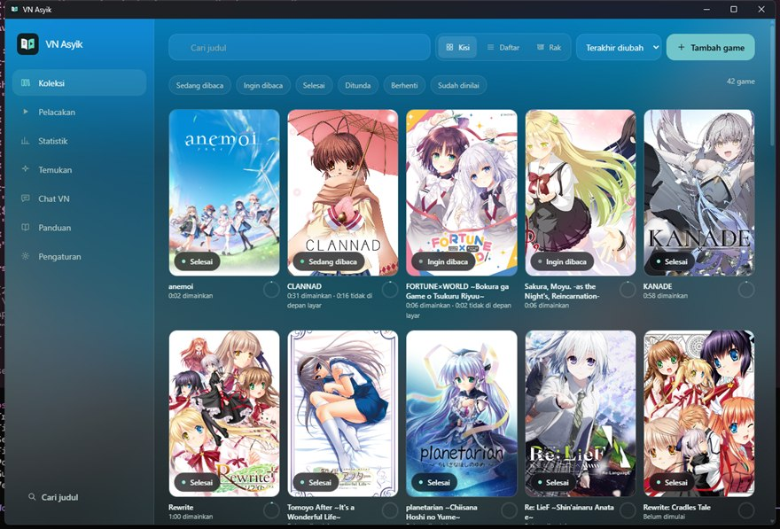

# VN Asyik

Kumpulkan visual novelmu di satu tempat dan catat waktu bacamu. Tersedia untuk Windows,
Android, dan Linux (Beta). Koleksi tersimpan di perangkatmu dan tetap bisa dibuka tanpa
internet.

[English](README.md) · **Bahasa Indonesia**



## Unduh

Ambil prarilis terbaru di [GitHub Releases](https://github.com/Atho64/VN-Asyik/releases).

- Windows: installer `.exe` atau `.msi`. Keduanya belum ditandatangani, jadi SmartScreen
  mungkin menampilkan peringatan.
- Android: `app-universal-release.apk` yang sudah ditandatangani.
- Linux (Beta): `.AppImage`. Beri izin eksekusi, lalu jalankan.

Buka **Panduan** di dalam aplikasi untuk bantuan pengaturan.

## Fitur

- Impor game dari VNDB beserta kover, tag, rating, dan screenshot.
- Jalankan game dan catat waktu baca, dengan waktu istirahat dihitung terpisah.
- Simpan catatan sesi, pengingat save slot, rute, dan ending agar ingat terakhir sampai mana.
- Ikuti panduan Seiya-Saiga dengan pilihan rute dan opsi terjemahan.
- Lihat lini masa, aktivitas harian, dan streak baca. Bagikan rekap tahunan atau seluruh
  riwayat bacamu.
- Ambil screenshot game di Windows atau Android, lalu lihat hasilnya per game.
- Pilih tampilan kisi, daftar, atau rak, atau gunakan Big Picture dengan keyboard atau stik.
- Pilih tema, atur warna, dan sembunyikan atau buramkan gambar eksplisit.
- Tampilkan game yang sedang kamu baca di Discord lewat Rich Presence, yang awalnya nonaktif.
- Sinkronkan lewat folder bersama, atau buat cadangan `.vn-asyik-library`. Cadangan memuat
  catatan baca dan screenshot; sinkronisasi folder tidak menyertakan screenshot.

Di desktop, menutup jendela secara bawaan menyembunyikannya ke system tray agar pelacakan
bisa berlanjut. Gunakan `Ctrl+K` untuk perintah cepat, `Ctrl+Shift+B` untuk Big Picture, dan
`Shift+S` untuk screenshot saat jendela game aktif di Windows. Game tetap menerima
kombinasi tombol tersebut.

## Cara pelacakan bekerja

Di desktop, waktu baca dihitung saat jendela game aktif, di luar jeda panjang tanpa
aktivitas. Deteksi bab otomatis bekerja jika game menulis progres di judul jendelanya,
seperti beberapa game Siglus. Buka **Pengaturan > Pelacakan** untuk memilih deteksi Siglus
atau menguji pola khusus. Jika bab tidak terdeteksi, waktu baca game tetap tercatat.

Android membutuhkan izin **Usage Access** untuk melacak game langsung maupun emulator;
bab dan rute diisi manual. Pelacakan Linux bekerja lewat X11 dan XWayland, tetapi belum bisa
melacak jendela Wayland native. Screenshot Android membutuhkan izin pencerminan layar dan
menangkap seluruh layar; Windows menangkap jendela game.

Catatan save slot hanya pengingat. VN Asyik tidak memuat save, mengubah berkas game, atau
membaca memori game.

## Fitur Beta

Aktifkan **Pengaturan > Umum > Fitur Beta** untuk membuka Rekomendasi, Chat VN, dan Teman
baca. Fitur ini tersembunyi secara bawaan.

- **Untukmu** menyarankan VN berdasarkan game yang kamu mainkan dan beri nilai, melalui tag
  dan kreatornya. Data diambil dari VNDB tanpa model AI atau kunci API. **Tanya** mencari
  lewat Tavily dan bisa memakai penyedia chat untuk menjawab dengan sumber.
- Chat VN bisa membahas koleksimu, teks langsung dari LunaTranslator, atau skrip hasil
  impor. Ringkasan cerita lengkap membutuhkan pilihan **Izinkan semua spoiler** di chat.
- Teman baca menyediakan obrolan dengan kepribadian pilihanmu, ingatan opsional, dan overlay
  desktop. Di Windows, kamu juga bisa mengizinkannya melihat satu jendela game dan bereaksi
  terhadap adegan. Suara belum tersedia. Pengembangan lanjutan teman baca sedang dijeda.

Untuk chat, atur penyedia, model, dan kunci API jika diperlukan di Pengaturan. Kunci disimpan
oleh sistem operasi. Konteks yang kamu bagikan dikirim ke penyedia tersebut, dan panggilan
bisa dikenai biaya. Teks langsung, penggunaan ingatan, dan reaksi otomatis perlu diaktifkan
masing-masing. Riwayat teman baca, ingatan, dan skrip impor tidak ikut sinkronisasi atau
cadangan pustaka. Android tidak memiliki overlay mengambang dan bisa menghentikan teman
baca di latar belakang.

Tidak ada telemetri atau analitik. Fitur online terhubung ke layanan yang kamu pilih untuk
dipakai, seperti VNDB, Discord, panduan Seiya-Saiga, dan penyedia chat.

## Pengembangan

Dibuat dengan Rust, Tauri v2, SQLite, React, dan TypeScript. Pasang Rust, Node.js, pnpm, serta
dependensi sistem Tauri, lalu jalankan:

```sh
pnpm install --frozen-lockfile
pnpm tauri dev
```

Buat installer desktop dengan `pnpm tauri build`. Build Android juga membutuhkan JDK 21,
Android SDK/NDK, serta target Rust Android:

```sh
pnpm tauri android build --apk --target aarch64
```

Installer desktop ada di `target/release/bundle/`, kecuali kamu mengatur direktori target
Cargo lain. Mulai membaca kode dari `crates/vn-core` untuk logika inti, `src-tauri/src` untuk
backend, dan `src/` untuk antarmuka.

<details>
<summary>Pemeriksaan pengembangan</summary>

```sh
pnpm lint && pnpm typecheck && pnpm test
cargo fmt --check && cargo clippy --all-targets -- -D warnings
cargo test --workspace
cargo check --target aarch64-linux-android -p vn-tracker
```

Tes pelacakan langsung memakai jendela dan waktu diam sesungguhnya, jadi jalankan terpisah:

```sh
cargo test --test tracking_live -- --ignored --nocapture
```

</details>

## Kredit

- [EwE](https://github.com/VaternID/EwE) (GPL-3.0): kode pengolahan teks presence Discord dan
  pergantian teks per kolom diport, dengan asal-usul tercatat di `crates/vn-core/src/presence.rs`.
- [Kizzy](https://github.com/dead8309/Kizzy) (GPL-3.0): inspirasi presence Discord di Android.
- [KireiBox](https://github.com/Yukin0a/KireiBox) (GPL-3.0): inspirasi peluncuran engine Android
  yang dipasang terpisah.
- [LunaTranslator](https://github.com/HIllya51/LunaTranslator) (GPL-3.0): integrasi teks
  langsung lewat API jaringan yang terdokumentasi; tidak ada kode yang disalin.
- LunaBox (AGPL-3.0): hanya inspirasi fitur; tidak ada kode yang disalin.

## Lisensi

GPL-3.0-only. Lihat [LICENSE](LICENSE).

Font Inter Tight memakai SIL Open Font License 1.1. Teks hak cipta dan lisensi lengkap ada
di [README Inggris](README.md#inter-tight-license).
