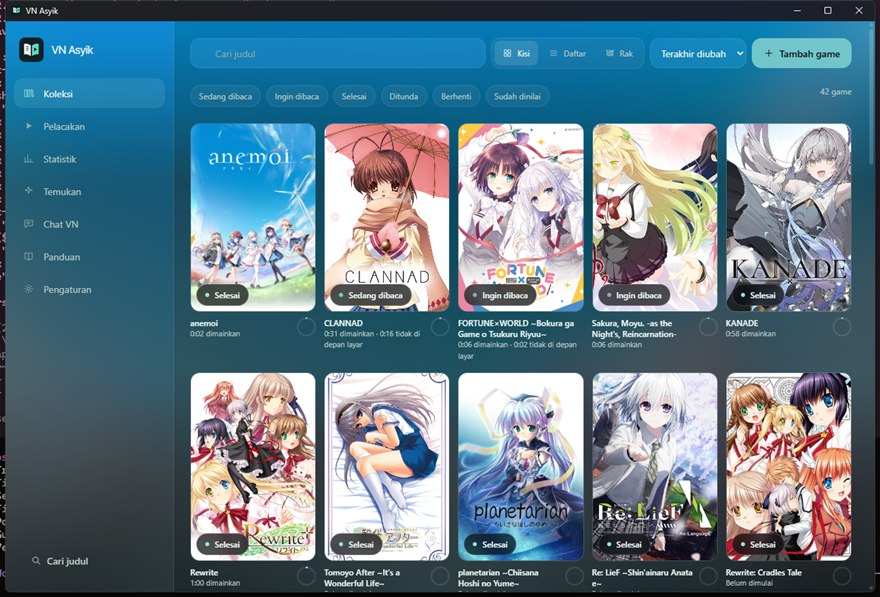

# VN Asyik

Kumpulkan visual novelmu di satu tempat dan catat waktu bacamu. Tersedia untuk Windows,
Android, dan Linux (Beta). Koleksi tersimpan di perangkatmu dan tetap bisa dibuka tanpa
internet.

[English](README.md) · **Bahasa Indonesia**



## Unduh

Ambil prarilis terbaru di [GitHub Releases](https://github.com/Atho64/VN-Asyik/releases).

- Windows: installer `.exe` atau `.msi`. Keduanya belum ditandatangani, jadi SmartScreen
  mungkin menampilkan peringatan.
- Android: `app-universal-release.apk` yang sudah ditandatangani.
- Linux (Beta): `.AppImage`. Beri izin eksekusi, lalu jalankan.

Buka **Panduan** di dalam aplikasi untuk bantuan pengaturan.

## Fitur

- Impor game dari VNDB beserta kover, tag, rating, dan screenshot.
- Jalankan game dan catat waktu baca, dengan waktu istirahat dihitung terpisah.
- Simpan catatan sesi, pengingat save slot, rute, dan ending agar ingat terakhir sampai mana.
- Ikuti panduan Seiya-Saiga dengan pilihan rute dan opsi terjemahan.
  Nama karakter dari data VNDB yang tersimpan diganti sebelum diterjemahkan oleh Google.
  Gunakan tombol **Segarkan terjemahan Google** untuk menerjemahkan ulang dari panduan
  Jepang sambil mempertahankan tanda centang pilihan.
- Di Windows, **Pilih jendela** saat menambahkan executable menautkan program dari
  jendela game yang terbuka. Pemilih file juga tetap tersedia.
- Lihat lini masa, aktivitas harian, dan streak baca. Bagikan rekap tahunan atau seluruh
  riwayat bacamu.
- Dapatkan pencapaian otomatis dari riwayat bacamu: 65 milestone seputar waktu baca, streak, tamat, rute, ending, catatan, dan screenshot, dengan progres untuk yang masih terkunci.
- Buat target baca custom (waktu baca atau VN tamat) per hari, minggu, bulan, tahun, atau target sekali sepanjang waktu, plus target manual dan catatan lintas game.
- Ambil screenshot game di Windows atau Android, lalu lihat hasilnya per game.
- Pilih tampilan kisi, daftar, atau rak, atau gunakan Big Picture dengan keyboard atau stik.
- Pilih tema, atur warna, dan sembunyikan atau buramkan gambar eksplisit.
- Tampilkan game yang sedang kamu baca di Discord lewat Rich Presence, yang awalnya nonaktif.
- Sinkronkan lewat folder bersama, atau buat cadangan `.vn-asyik-library`. Cadangan memuat
  catatan baca dan screenshot; sinkronisasi folder tidak menyertakan screenshot.

Di desktop, menutup jendela secara bawaan menyembunyikannya ke system tray agar pelacakan
bisa berlanjut. Gunakan `Ctrl+K` untuk perintah cepat, `Ctrl+Shift+B` untuk Big Picture, dan
`Shift+S` untuk screenshot saat jendela game aktif di Windows. Game tetap menerima
kombinasi tombol tersebut.

**Edit terjemahan** menampilkan judul rute dan langkah di samping sumber Jepang,
lalu menyimpan **Terjemahan saya** secara lokal tanpa mengganti terjemahan Google.
Nama alternatif game dilipat agar halaman game lebih ringkas. Sidebar desktop bisa
diciutkan tanpa memuat ulang layar yang sedang dibuka.

Pengaturan Discord mendukung gambar besar dan kecil, tooltip gambar, serta hingga
dua tombol kustom dengan label dan URL HTTP(S). Aset kustom dari URL memakai penanda
di pratinjau lokal; Discord yang memuat gambar aslinya.
Di Windows, ikon kecil yang kosong memakai ikon executable yang ditautkan secara bawaan.
Pilih Host Gambar agar tampil di Discord, atau matikan **Pakai ikon executable saat kosong**
untuk menyembunyikannya. Ikon yang diekstrak tetap lokal selama Host Gambar masih Tidak ada.

Klik kanan screenshot untuk **Salin gambar** di desktop atau **Simpan gambar** sebagai PNG.
Menu juga bisa dibuka dengan `Shift+F10` saat screenshot mendapat fokus keyboard. Hasil
ekspor tetap buram jika gambar yang ditampilkan buram; buka screenshot terlebih dahulu
untuk gambar ukuran penuh. Kalender aktivitas menandai sesi baca pertama yang tercatat
dengan titik kosong dan penyelesaian VN dengan titik penuh.

## Cara pelacakan bekerja

Di desktop, waktu baca dihitung saat jendela game aktif, di luar jeda panjang tanpa
aktivitas. Deteksi bab otomatis bekerja jika game menulis progres di judul jendelanya,
seperti beberapa game Siglus. Buka **Pengaturan > Pelacakan** untuk memilih deteksi Siglus
atau menguji pola khusus. Jika bab tidak terdeteksi, waktu baca game tetap tercatat.

Dalam mode pelacakan sesuai fokus, timer rute dan bab berhenti sementara dengan status
**Jendela tidak aktif** saat berpindah jendela, lalu berlanjut saat kembali. Status
**Dijeda** berarti tombol Jeda ditekan.

Android membutuhkan izin **Usage Access** untuk melacak game langsung maupun emulator;
bab dan rute diisi manual. Pelacakan Linux bekerja lewat X11 dan XWayland, tetapi belum bisa
melacak jendela Wayland native. Windows menangkap jendela game. Di Android, mulai
screenshot dari halaman game yang dipilih, izinkan berbagi layar, kembali ke game,
lalu tekan **Tangkap (3 detik)** di notifikasi dan tutup panelnya dalam tiga detik.
Android 14+ menawarkan berbagi satu aplikasi; versi lama berbagi seluruh layar.
Berbagi berhenti setelah satu gambar, Batal, pencabutan izin oleh OS, atau dua menit.
Notifikasi harus aktif dan konten terlindungi bisa tampil kosong. Jalur Android ini
sudah diimplementasikan dan diuji kompilasinya; tangkapan di perangkat belum diverifikasi.

Catatan save slot hanya pengingat. VN Asyik tidak memuat save, mengubah berkas game, atau
membaca memori game.

## Jelajahi

Buka **Jelajahi** untuk menelusuri rekomendasi VNDB yang dicocokkan dengan game yang kamu
mainkan dan beri nilai, berdasarkan tag, studio, penulis, ilustrator, dan pengisi suaranya.
Data diambil langsung dari VNDB tanpa model AI atau kunci API.

Tidak ada telemetri atau analitik. Fitur online hanya terhubung ke layanan yang kamu pilih
untuk dipakai, seperti VNDB, Discord, dan panduan Seiya-Saiga.

## Pengembangan

Dibuat dengan Rust, Tauri v2, SQLite, React, dan TypeScript. Pasang Rust, Node.js, pnpm, serta
dependensi sistem Tauri, lalu jalankan:

```sh
pnpm install --frozen-lockfile
pnpm tauri dev
```

Buat installer desktop dengan `pnpm tauri build`. Build Android juga membutuhkan JDK 21,
Android SDK/NDK, serta target Rust Android:

```sh
pnpm tauri android build --apk --target aarch64
```

Installer desktop ada di `target/release/bundle/`, kecuali kamu mengatur direktori target
Cargo lain. Mulai membaca kode dari `crates/vn-core` untuk logika inti, `src-tauri/src` untuk
backend, dan `src/` untuk antarmuka.

<details>
<summary>Pemeriksaan pengembangan</summary>

```sh
pnpm lint && pnpm typecheck && pnpm test
cargo fmt --check && cargo clippy --all-targets -- -D warnings
cargo test --workspace
cargo check --target aarch64-linux-android -p vn-tracker
```

Tes pelacakan langsung memakai jendela dan waktu diam sesungguhnya, jadi jalankan terpisah:

```sh
cargo test --test tracking_live -- --ignored --nocapture
```

</details>

## Kredit

- [EwE](https://github.com/VaternID/EwE) (GPL-3.0): kode pengolahan teks presence Discord dan
  pergantian teks per kolom diport, dengan asal-usul tercatat di `crates/vn-core/src/presence.rs`.
- [Kizzy](https://github.com/dead8309/Kizzy) (GPL-3.0): inspirasi presence Discord di Android.
- [KireiBox](https://github.com/Yukin0a/KireiBox) (GPL-3.0): inspirasi peluncuran engine Android
  yang dipasang terpisah.

## Lisensi

GPL-3.0-only. Lihat [LICENSE](LICENSE).

Font Inter Tight memakai SIL Open Font License 1.1. Teks hak cipta dan lisensi lengkap ada
di [README Inggris](README.md#inter-tight-license).
