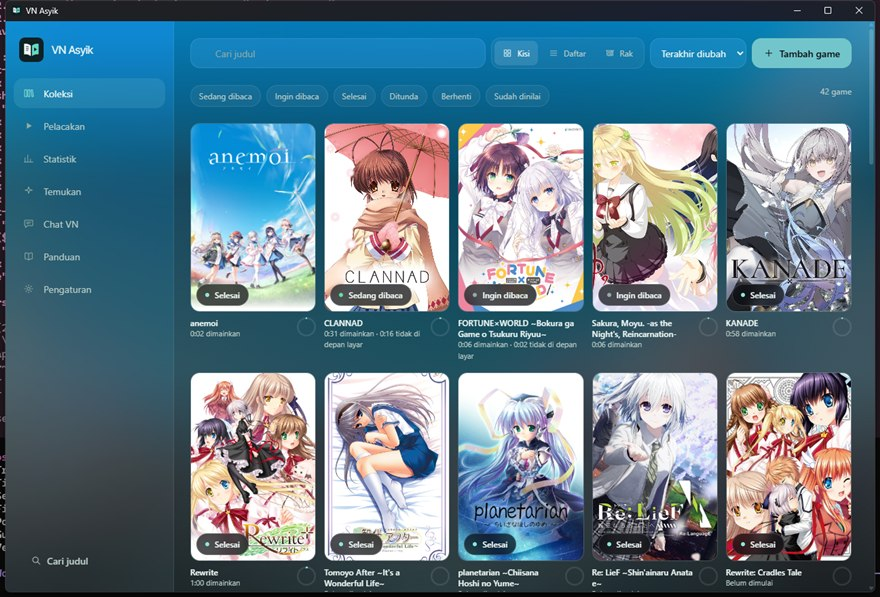

# VN Asyik

A visual novel library and playtime tracker for Windows and Android. It reads
from VNDB, keeps everything in a local SQLite database, and works with no
network. Rust and Tauri on the backend, React on the front.

**English** · [Bahasa Indonesia](README.id.md)



## What it does

**Library.** Search VNDB and import a game with its cover, tags, ratings and
screenshot gallery. Browse as a grid, list or shelf; all three are virtualized.
Explicit covers stay concealed behind a neutral surface until you ask to see
one, and changing that setting conceals them again.

**Playtime.** Start a game from the app and it records how long you actually
read. Time counts only while the game is in front of you; breaks longer than a
configurable threshold are filed as away time instead of playtime, and stored
separately so you can see both. Sessions are written every 20 seconds, so a
crash or a forced reboot costs you seconds, not an evening.

**Reading journal.** **Where did I leave off?** on the game page shows the latest
recorded reading session and its known chapter/route. Add, edit or delete session
notes with manual save-slot reminders, plus a shortcut to the game's walkthrough.
Open any session in the history to view its times, recorded route/chapter and
checkpoints, or add a note to that older session. Older/newer page controls keep
the whole history accessible in batches of 50, with a short note preview on each session.
Entries travel with library sync and backups. Save slots are reminders: the app
does not load or modify game saves.

**Big Picture.** A full-screen launcher with a selected-game hero and a compact
cover rail. Click a cover to select it, then use Play or Enter to launch. Keyboard
and controller navigation work across the whole collection; only the visible
cover group is rendered. Open it from the library or with Ctrl+Shift+B.

**Chapters and endings.** Routes are yours: you name them, and endings hang off
them. Chapter detection reads the game's window caption where the engine writes
one (see [Chapters from the window title](#chapters-from-the-window-title)) and
falls back to game-level attribution where it does not, which is the honest
answer for a game that reports nothing.

**Stats.** Playtime by game, route and month, from the sessions themselves. A
play-day heatmap with current and longest reading streaks, and a year-in-review
card that sums up any recorded year: time read, days read, endings reached,
journal entries, games started and finished, the longest sitting, the first
game of the year, and the five games you spent the most time in.

**Timeline.** Your reading journey across every game in one feed: sessions,
journal notes, endings reached and finished games, newest first, grouped by
day. Covers follow the same content setting as the library, and every row
opens the game page.

**Discord Rich Presence.** Optional, off by default. Shows what you are reading,
rotating through whatever fields you configure. Explicit cover art is blurred
before it is ever sent anywhere, if you opt into an image host at all.

**Walkthroughs.** Pull route choices directly from the Seiya-Saiga index.
Step-by-step choices, route branches, and ending badges are organized into
clean tabs, backed by normalized Japanese title search and inline translation
options.

**Recommendations.** Ask what to read next. A taste profile is computed
locally from the VNDB tags of the games in your library, and questions can
reach the open web through Tavily searches that always link back to cited
sources rather than guessing without receipts.

**Sync and backups.** Sync libraries and sessions across devices over a shared
folder on your local network (LAN) without third-party servers. Or export your
entire collection into a single `.vn-asyik-library` file with transparent
conflict review on import.

**Command palette.** Press `Ctrl+K` (or `Cmd+K`) anywhere for quick keyboard
navigation: jump across screens, find any title in your library instantly, and
trigger common actions.

**Background operation & System Tray.** On desktop, hide VN Asyik into the taskbar
notification area (system tray) using the sidebar button, `Ctrl+Shift+H`, the Command
Palette, or simply by closing the window ('X'). Playtime tracking and LunaTranslator
text hooking continue in the background while you read your visual novel,
and the window can be instantly restored by clicking the tray icon.

**Android.** Playtime comes from `UsageStats` foreground events, which needs the
Usage Access permission, whether running games natively or inside emulators.
Android cannot see inside another app's windows, so chapters there are set by
hand and the app says so rather than guessing.

While a game stays in the foreground, each periodic check updates one local
checkpoint. History receives a completed session when that reading stretch ends,
such as when switching apps, locking the screen, or pressing Stop. Older
15-second history fragments are preserved; the fix applies to new recording.

## Chapters from the window title

On desktop, chapters come from what the game writes in its own window caption:
no injection, no memory reading, nothing that a game update can break. Siglus
puts its progress there, and these shapes are verified:

```text
Summer Pockets REFLECTION BLUE 静久 ８月７日   route 静久, chapter 8月7日
anemoi Ｄａｙ １                              chapter Day 1
anemoi アネモイ Ｃｈａｐｔｅｒ ０１            route アネモイ, chapter Chapter 01
```

Full-width characters are folded before matching, so `Ｄａｙ １` and `Day 1` read
the same. A caption with no marker (the title screen, a menu) attributes
nothing rather than inventing a chapter, a bare number is not a chapter, and a
caption that does not name the game you track is ignored.

### Custom pattern

If your game writes a shape none of those cover, open **Settings → General →
Reading chapters from window titles**, set **Source** to **Custom pattern**, and
fill in a pattern. It is Rust [`regex`](https://docs.rs/regex) 1.x syntax:
linear-time, no look-around, no backreferences, at most 512 bytes (about 170
Japanese characters). It runs against the whole caption the way the game
wrote it, game name included.

- **Two groups:** the first is the route, the second is the chapter.
- **One group:** it is the chapter.

At least one group is required; a pattern without one is refused when you save.
Groups that did not take part in the match are skipped, so an optional route
group leaves just the chapter.

Two properties of that dialect are worth knowing for Japanese captions: `\d`
matches any Unicode digit (full-width `１２` included), and `(?i)` gives
case-insensitive matching.

For a caption like `Fate/stay night [Fate] Day 3`:

```text
^.*?\[(.+)\]\s*(.+)$    route "Fate", chapter "Day 3"
^.*?\s(Day \d+)$        chapter "Day 3"            (one group)
```

What to know before saving:

- The pattern is not anchored: it matches anywhere in the caption unless you
  write `^` and `$` yourself.
- A match whose group captured nothing is treated as no match: an empty chapter
  name is worse than none.
- Custom patterns do **not** fold full-width characters: `Day` never matches
  `Ｄａｙ`, because they are different characters. For a caption written that way,
  either put those characters in the pattern or leave the source on **Siglus**,
  which folds them.
- **Test** runs the pattern against the sample caption, prefilled from whichever
  window was in front when the panel opened; edit it to try another. Test
  before saving: a pattern that never matches looks exactly like a game that
  writes no chapter, and nothing else in the app can tell them apart.

**Off** stops reading captions. The choice is stored locally on this device.
Android never reads captions (the OS does not allow it), so chapters there are
set by hand.

## Beta features

Companion, Discover (VN search with an API key), and VN Chat are hidden by
default. Enable **Settings → General → Beta features** to show them and their
setup tools. This choice is local to each device; library imports do not enable it.
Turning it off pauses the companion, clears window capture, cancels chat replies,
disconnects Luna live text, and hides the overlay. Saved keys, settings, memories,
and history are kept. Enabling it again does not resume a companion session or
window capture automatically. Further companion development is currently paused.
Normal library search, VNDB lookup/import, and tracking remain available.

## Companion chat

Choose **Read with companion** on a game page, or open **Companion**, to start a
reading session. Select a game and personality, then choose typed
passages or a LunaTranslator feed you have explicitly matched to that game.
Expand **Reading context** for the optional session name and reading boundary.
Replies continue while you navigate or minimize the Windows app. Pause stops
new dialogue and replies; **Stop reply** interrupts the current answer; **End
session** closes the context. After loading an earlier save or changing routes,
open **Session options** (the gear) and choose **New session** to start a fresh
context and transcript. Model details, history and End session live in that
panel; Pause and Send remain beside the conversation. Send becomes Stop reply
while an answer is running. Completed tool details are available under Sources.

Knowledge is explicit: **Metadata only**, **Only what I share**, or
**All spoilers**. Luna input is limited to fresh lines received after starting
or resuming. A lost or replaced connection pauses the session and requires
confirmation before reading resumes. Questions use your selected provider;
automatic reactions and recap suggestions require separate opt-ins. Sessions are
local, excluded from sync and library exports, and keep up to 200 recent messages each. Ended histories
can be read or deleted, including after removing their game. Restarting the app
never resumes a session automatically.

On desktop, **Open overlay** opens a small, movable, resizable window that stays
on top, with the same conversation and pause/end controls. **Hide** or the window
close button hides it while the reply continues; reopen it to catch up. Setup,
settings and library links open in the main app. Use windowed or borderless games:
exclusive fullscreen can cover native windows. Android has no floating overlay.

Choose from twelve personalities, or use **Customize** to save a local profile
with its own speaking style, interests, reply length, language and tone. Sample
replies are authored examples; viewing them makes no model call. In **Session
options**, **Apply personality** changes the current session and stops any reply
still using its previous personality. Saving or deleting a profile alone leaves
session copies intact. Profiles and companion history are excluded from library
exports and sync.

**Session options → Review memories** adds local durable memory. Use
**Remember this** for a preference or a reviewed passage, then choose its scope:
all companions, this identity, or this game and playthrough. **Use saved memories**
is a separate opt-in, off by default. Review, search, edit and pin saved items.
**Suggest a recap** calls the selected model only when requested; automatic
recap suggestions have a separate opt-in and may incur provider charges.
Suggestions never enter retrieval until approved. Interrupted recaps pause
until explicitly retried, and saved evidence survives the 200-message window.

**Forget** clears the selected memory and evidence. Corrections and Forget also
invalidate derived recaps and exclude all earlier companion exchanges from
future prompts, while retaining readable local transcripts. This deliberately
loses recent conversational continuity; it cannot retract content already sent
to a provider. New sessions never inherit another playthrough's story memories.
Memory is excluded from sync, backups and exports. Deleting a session removes
its derived memories; independently authored preferences remain.

**Vision** adds selected-window scenes on Windows. Choose one game window,
inspect the local preview and optional crop, then explicitly **Test image support**
for your selected provider. Send one image with a question, or enable **Watch and
react** for occasional text reactions while that game is foreground. Image calls
may cost money. Automatic calls are at least 60 seconds apart, capped at 12/hour
and 30/session; silence, failures and cancelled dispatched requests count too.
**Quiet** stops automatic replies; **Stop watching**, session Pause/End and Forget
clear capture. Watching never restarts at app launch. Images stay in memory only;
history retains text labelled as visual inference and minimal source metadata.
Windows SDR capture is supported; HDR and other platforms report unavailable.

This includes text sessions, friend identities, durable memory, and vision
with occasional reactions. Voice remains planned. Android does
not guarantee background operation; keep the app open there.

The chat is not a general assistant bolted onto a library. It can read two
things and cite them:

- **Live text.** Text LunaTranslator extracted from the game you are playing
  right now.
- **Imported scripts.** Drop in a script you extracted yourself: plain text, a
  name/message JSON array, or the Asyik JSON format. The app compacts it
  into a story digest it can answer from.

Compaction is a map-reduce over the script split into byte-budgeted chunks. Up
to 10 agents summarize contiguous segments in parallel, each carrying the tail
of its own previous outline for continuity, then their segment digests merge
into one. Progress is saved per chunk, so closing the app mid-run and coming
back resumes where it stopped instead of starting over.

Digests are withheld unless the chat's spoiler level is set to _All_. Ordinary
chat can read live text at every spoiler level; companion sessions additionally
withhold captured dialogue in **Metadata only** mode.

### Providers

Settings keeps a list of saved providers rather than one endpoint: a name, an
OpenAI-compatible base URL and a model each. The keys live in the OS credential
store, one slot per provider, never in the database or a config file, and
switching provider does not mean retyping a key. The one setting that existed
before this list is migrated into a profile on first run, key included.

Two endpoints are known to work through the compatibility layer:

| Provider         | Endpoint                                                  | Example model      |
| ---------------- | --------------------------------------------------------- | ------------------ |
| Google AI Studio | `https://generativelanguage.googleapis.com/v1beta/openai` | `gemini-2.5-flash` |
| Local runtime    | `http://127.0.0.1:11434/v1` (Ollama)                      | `qwen3`            |

Plain `http` is accepted only on localhost, because anywhere else it would send
the key in clear text.

## What it will not do

Some of this is a platform limit and some is a decision, but either way the app
tells you rather than pretending.

- **No chapter detection on Android.** The OS does not let one app inspect
  another's window. Chapter and route are manual there.
- **The app never writes to a running game.** It does not patch files, re-inject
  translated text, or touch DRM.
- **No telemetry.** No analytics, no crash reporting, no phone-home. The only
  network calls are the ones you turn on: VNDB, Discord, your own chat provider,
  and Tavily if you ask for a recommendation that needs the open web.

## Install

Download the latest prerelease from [GitHub Releases](https://github.com/Atho64/VN-Asyik/releases).
Windows has `.exe` and `.msi` installers; both are unsigned and may show a
SmartScreen warning. Android uses the signed `app-universal-release.apk`.

To build from source:

```
pnpm install --frozen-lockfile
pnpm tauri build
```

Output lands in `target/release/bundle/` unless a Cargo target directory is
configured. Android needs JDK 21, the Android SDK and NDK, and the Android Rust target:

```
pnpm tauri android build --apk --target aarch64
```

The application ID is `com.atho.vnasyik`. Android keys app data, the Keystore
credential store and the Usage Access grant to that string, so it is permanent:
changing it again makes the store treat the app as a different installation.

## Upgrading from the `app.vntracker.desktop` build

The package was renamed once, before the first public release. A build made
before the rename cannot update in place, because Android sees a different app:
it installs alongside the old one with an empty library.

- **Android:** export with _Settings → Backup & transfer_ in the old build, then
  import in this one.
- **Windows:** the library lives in `%APPDATA%\com.atho.vnasyik\`. Copy the
  folder from `%APPDATA%\app.vntracker.desktop\` before the first launch, and
  the games, sessions and settings come with it.

## Development

```
pnpm install --frozen-lockfile
pnpm tauri dev
```

```
pnpm lint && pnpm typecheck && pnpm test
cargo fmt --check && cargo clippy --all-targets -- -D warnings
cargo test --workspace
```

The live tracking tests touch real windows and real idle time, so they are
ignored by default:

```
cargo test --test tracking_live -- --ignored --nocapture
```

Android compile check, which catches code that leaks out from behind a
`#[cfg]` gate:

```
cargo check --target aarch64-linux-android -p vn-tracker
```

## Reading the code

`crates/vn-core` is the place to start: it holds the pure domain logic (the
session state machine, sync merge, chapter mapping, script compaction) with no
Tauri and no OS calls, so it tests with plain `cargo test`. `src-tauri/src` wraps
that in commands, storage and platform adapters. `src/` is the React frontend and
talks to the backend only through `src/lib/ipc`.

Comments in the code explain _why_ a rule exists where the rule is not obvious,
so the reasoning travels with the code rather than living in a separate
document.

## Prior art and attribution

Each entry below says what it actually gave this project. _Ported_ means code or
constants were copied and carry provenance comments in the source. _Inspiration_
means the project was read to understand a problem; nothing was copied.

**[VaternID/EwE](https://github.com/VaternID/EwE)** (GPL-3.0, ported).
The Discord presence card is modelled on EwE. `crates/vn-core/src/presence.rs`
records what was taken: the per-field text transform pipeline (remove, replace,
prefix/suffix, trim, in that order) and the independent rotation cursor per
field. What was deliberately not taken is recorded too: EwE's custom Python
variable scripts, which execute arbitrary code from a directory beside the
executable, and its upload of cover art without a separate opt-in.

**[dead8309/Kizzy](https://github.com/dead8309/Kizzy)** (GPL-3.0, inspiration).
The reference for talking to Discord on Android, where the desktop IPC socket
does not exist. The Android presence path connects to the Discord Gateway
directly instead, which is the approach Kizzy demonstrated. No code is shared.

**[Yukin0a/KireiBox](https://github.com/Yukin0a/KireiBox)** (GPL-3.0, inspiration).
A reference for how Android VN launchers approach externally installed engines.
Its README draws the line between bundled engine runners and launching a
separately installed app; VN Asyik takes the second path and bundles nothing.

**[LunaTranslator](https://github.com/HIllya51/LunaTranslator)** (GPL-3.0, integrated).
Connected through its documented network service: the websocket endpoint streams
extracted text as plain frames, which the app consumes. No code is copied; the
integration is a client for a documented API.

**LunaBox** (AGPL-3.0, inspiration only).
Read as prior art for what an AI feature over a VN library could present, and for
which failure modes matter (spoilers, invented conclusions).

## License

GPL-3.0-only. See [LICENSE](LICENSE).

## Inter Tight license

The bundled Inter Tight font remains under its own license:

```text
Copyright 2022 The Inter Project Authors (https://github.com/rsms/inter-tight)

This Font Software is licensed under the SIL Open Font License, Version 1.1.
This license is copied below, and is also available with a FAQ at:
https://scripts.sil.org/OFL


-----------------------------------------------------------
SIL OPEN FONT LICENSE Version 1.1 - 26 February 2007
-----------------------------------------------------------

PREAMBLE
The goals of the Open Font License (OFL) are to stimulate worldwide
development of collaborative font projects, to support the font creation
efforts of academic and linguistic communities, and to provide a free and
open framework in which fonts may be shared and improved in partnership
with others.

The OFL allows the licensed fonts to be used, studied, modified and
redistributed freely as long as they are not sold by themselves. The
fonts, including any derivative works, can be bundled, embedded,
redistributed and/or sold with any software provided that any reserved
names are not used by derivative works. The fonts and derivatives,
however, cannot be released under any other type of license. The
requirement for fonts to remain under this license does not apply
to any document created using the fonts or their derivatives.

DEFINITIONS
"Font Software" refers to the set of files released by the Copyright
Holder(s) under this license and clearly marked as such. This may
include source files, build scripts and documentation.

"Reserved Font Name" refers to any names specified as such after the
copyright statement(s).

"Original Version" refers to the collection of Font Software components as
distributed by the Copyright Holder(s).

"Modified Version" refers to any derivative made by adding to, deleting,
or substituting -- in part or in whole -- any of the components of the
Original Version, by changing formats or by porting the Font Software to a
new environment.

"Author" refers to any designer, engineer, programmer, technical
writer or other person who contributed to the Font Software.

PERMISSION & CONDITIONS
Permission is hereby granted, free of charge, to any person obtaining
a copy of the Font Software, to use, study, copy, merge, embed, modify,
redistribute, and sell modified and unmodified copies of the Font
Software, subject to the following conditions:

1) Neither the Font Software nor any of its individual components,
in Original or Modified Versions, may be sold by itself.

2) Original or Modified Versions of the Font Software may be bundled,
redistributed and/or sold with any software, provided that each copy
contains the above copyright notice and this license. These can be
included either as stand-alone text files, human-readable headers or
in the appropriate machine-readable metadata fields within text or
binary files as long as those fields can be easily viewed by the user.

3) No Modified Version of the Font Software may use the Reserved Font
Name(s) unless explicit written permission is granted by the corresponding
Copyright Holder. This restriction only applies to the primary font name as
presented to the users.

4) The name(s) of the Copyright Holder(s) or the Author(s) of the Font
Software shall not be used to promote, endorse or advertise any
Modified Version, except to acknowledge the contribution(s) of the
Copyright Holder(s) and the Author(s) or with their explicit written
permission.

5) The Font Software, modified or unmodified, in part or in whole,
must be distributed entirely under this license, and must not be
distributed under any other license. The requirement for fonts to
remain under this license does not apply to any document created
using the Font Software.

TERMINATION
This license becomes null and void if any of the above conditions are
not met.

DISCLAIMER
THE FONT SOFTWARE IS PROVIDED "AS IS", WITHOUT WARRANTY OF ANY KIND,
EXPRESS OR IMPLIED, INCLUDING BUT NOT LIMITED TO ANY WARRANTIES OF
MERCHANTABILITY, FITNESS FOR A PARTICULAR PURPOSE AND NONINFRINGEMENT
OF COPYRIGHT, PATENT, TRADEMARK, OR OTHER RIGHT. IN NO EVENT SHALL THE
COPYRIGHT HOLDER BE LIABLE FOR ANY CLAIM, DAMAGES OR OTHER LIABILITY,
INCLUDING ANY GENERAL, SPECIAL, INDIRECT, INCIDENTAL, OR CONSEQUENTIAL
DAMAGES, WHETHER IN AN ACTION OF CONTRACT, TORT OR OTHERWISE, ARISING
FROM, OUT OF THE USE OR INABILITY TO USE THE FONT SOFTWARE OR FROM
OTHER DEALINGS IN THE FONT SOFTWARE.
```
