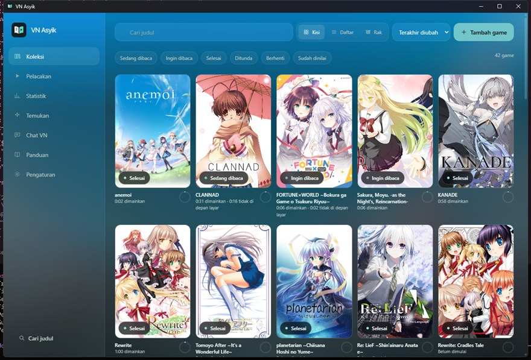

# VN Asyik

Keep your visual novels in one library and track how long you read. Available for
Windows, Android and Linux (Beta). Your collection stays on your device and works offline.

**English** · [Bahasa Indonesia](README.id.md)



## Download

Get the latest prerelease from [GitHub Releases](https://github.com/Atho64/VN-Asyik/releases).

- Windows: `.exe` or `.msi` installer. Both are unsigned, so SmartScreen may show a warning.
- Android: the signed `app-universal-release.apk`.
- Linux (Beta): `.AppImage`. Make it executable, then run it.

Open **Guide** inside the app for setup help.

## Features

- Import games from VNDB with covers, tags, ratings and screenshots.
- Launch games and record reading time, with breaks counted separately.
- Keep session notes, save-slot reminders, routes and endings so you know where you left off.
- Follow Seiya-Saiga walkthroughs with route choices and translation options.
- View your reading timeline, daily activity and streaks. Share yearly or all-time recap cards.
- Earn achievements automatically from your reading history: 65 milestones across playtime, streaks, finishes, routes, endings, notes and screenshots, with live progress for the ones still locked.
- Set custom reading goals (playtime or finished VNs) per day, week, month or year, or as a one-time all-time target, plus manual targets and cross-game notes.
- Save screenshots of your game on Windows or Android, grouped by game.
- Browse in grid, list or shelf view, or use Big Picture with a keyboard or controller.
- Choose a theme, adjust colours and control whether explicit artwork is hidden or blurred.
- Show what you are reading on Discord with optional Rich Presence, off by default.
- Sync through a shared folder, or export a `.vn-asyik-library` backup. Backups include
  reading notes and screenshots; folder sync does not include screenshots.

On desktop, closing the window hides it in the system tray by default so tracking can
continue. Use `Ctrl+K` for quick commands, `Ctrl+Shift+B` for Big Picture, and
`Shift+S` for screenshots while the game is focused on Windows. The game still receives
this key combination.

On Windows, **Choose a window** in the executable form links the program behind an
open game window. The file chooser remains available. Walkthroughs replace character
names using the cached VNDB cast before Google translation. Use **Refresh Google
translation** to regenerate from the Japanese guide while keeping your checked choices.

**Edit translation** lets you correct route titles and steps beside the Japanese
source, then save **My translation** locally without replacing the Google translation.
Alternate game titles fold under **Also known as** to keep game details
compact. The desktop sidebar can collapse while the current screen stays mounted.

Discord settings support large and small image assets, image tooltips, and up to
two custom buttons with labels and HTTP(S) URLs. Remote custom assets use a labelled
placeholder in the local preview; Discord resolves the actual image.
On Windows, a blank small-image field defaults to the linked executable's icon.
Choose an Image Host to publish it to Discord, or disable **Use executable icon when blank**
to hide it. Extracted icons stay local while Image Host is None.

Right-click a screenshot to **Copy image** on desktop or **Save image** as a PNG.
The menu also opens with `Shift+F10` when a screenshot has keyboard focus. Exports
keep the displayed blur; open a screenshot first for its full-size image. The activity
calendar marks the first counted reading session with a hollow dot and completion with a filled dot.

## Tracking notes

Desktop playtime counts while the game is focused, excluding long idle breaks. Automatic
chapter detection works when a game puts progress in its window title, as some Siglus games
do. **Settings > Tracking** lets you choose Siglus detection or test a custom pattern.
Without a chapter match, the app still records time for the game.

In focus-aware mode, route and chapter timers freeze with **Window not focused** when you
switch windows, then continue when you return. **Paused** means you pressed Pause.

Android needs **Usage Access** permission to track native games or emulators; chapters and
routes are manual. Linux tracking works with X11 and XWayland, but cannot track native
Wayland windows. Windows screenshots capture the game window. On Android, start a
screenshot from the selected game's page, approve screen sharing, return to the game,
then tap **Capture (3s)** in the notification and close the drawer within three seconds.
Android 14+ offers sharing one app; older versions share the whole display. Sharing
stops after one image, Cancel, OS revocation, or two minutes. Notifications must be
enabled, and protected content may appear blank. This Android path is implemented
and compile-tested; live device capture remains unverified.

Save-slot notes are reminders. VN Asyik does not load saves, modify game files or read game
memory.

## Discover

Open **Discover** to browse VNDB recommendations matched against games you have played and
rated, using their tags, studios, writers, artists and voice actors. It fetches directly
from VNDB without an AI model or API key.

There is no telemetry or analytics. Online features connect only to the services you choose
to use, such as VNDB, Discord and Seiya-Saiga walkthroughs.

## Development

Built with Rust, Tauri v2, SQLite, React and TypeScript. Install Rust, Node.js, pnpm and
Tauri's system dependencies, then run:

```sh
pnpm install --frozen-lockfile
pnpm tauri dev
```

Build a desktop installer with `pnpm tauri build`. Android builds also need JDK 21, the
Android SDK/NDK and the Android Rust target:

```sh
pnpm tauri android build --apk --target aarch64
```

Desktop bundles go to `target/release/bundle/` unless you configured another Cargo target
directory. Start reading the code in `crates/vn-core` for core logic, `src-tauri/src` for the
backend, and `src/` for the interface.

<details>
<summary>Development checks</summary>

```sh
pnpm lint && pnpm typecheck && pnpm test
cargo fmt --check && cargo clippy --all-targets -- -D warnings
cargo test --workspace
cargo check --target aarch64-linux-android -p vn-tracker
```

Live tracking tests use real windows and idle time, so run them separately:

```sh
cargo test --test tracking_live -- --ignored --nocapture
```

</details>

## Credits

- [EwE](https://github.com/VaternID/EwE) (GPL-3.0): ported Discord presence text transforms
  and per-field rotation, with provenance recorded in `crates/vn-core/src/presence.rs`.
- [Kizzy](https://github.com/dead8309/Kizzy) (GPL-3.0): inspiration for Android Discord presence.
- [KireiBox](https://github.com/Yukin0a/KireiBox) (GPL-3.0): inspiration for launching
  separately installed Android engines.

## License

GPL-3.0-only. See [LICENSE](LICENSE).

### Inter Tight license

The bundled Inter Tight font uses the SIL Open Font License 1.1.

<details>
<summary>Full font copyright notice and license</summary>

```text
Copyright 2022 The Inter Project Authors (https://github.com/rsms/inter-tight)

This Font Software is licensed under the SIL Open Font License, Version 1.1.
This license is copied below, and is also available with a FAQ at:
https://scripts.sil.org/OFL


-----------------------------------------------------------
SIL OPEN FONT LICENSE Version 1.1 - 26 February 2007
-----------------------------------------------------------

PREAMBLE
The goals of the Open Font License (OFL) are to stimulate worldwide
development of collaborative font projects, to support the font creation
efforts of academic and linguistic communities, and to provide a free and
open framework in which fonts may be shared and improved in partnership
with others.

The OFL allows the licensed fonts to be used, studied, modified and
redistributed freely as long as they are not sold by themselves. The
fonts, including any derivative works, can be bundled, embedded,
redistributed and/or sold with any software provided that any reserved
names are not used by derivative works. The fonts and derivatives,
however, cannot be released under any other type of license. The
requirement for fonts to remain under this license does not apply
to any document created using the fonts or their derivatives.

DEFINITIONS
"Font Software" refers to the set of files released by the Copyright
Holder(s) under this license and clearly marked as such. This may
include source files, build scripts and documentation.

"Reserved Font Name" refers to any names specified as such after the
copyright statement(s).

"Original Version" refers to the collection of Font Software components as
distributed by the Copyright Holder(s).

"Modified Version" refers to any derivative made by adding to, deleting,
or substituting -- in part or in whole -- any of the components of the
Original Version, by changing formats or by porting the Font Software to a
new environment.

"Author" refers to any designer, engineer, programmer, technical
writer or other person who contributed to the Font Software.

PERMISSION & CONDITIONS
Permission is hereby granted, free of charge, to any person obtaining
a copy of the Font Software, to use, study, copy, merge, embed, modify,
redistribute, and sell modified and unmodified copies of the Font
Software, subject to the following conditions:

1) Neither the Font Software nor any of its individual components,
in Original or Modified Versions, may be sold by itself.

2) Original or Modified Versions of the Font Software may be bundled,
redistributed and/or sold with any software, provided that each copy
contains the above copyright notice and this license. These can be
included either as stand-alone text files, human-readable headers or
in the appropriate machine-readable metadata fields within text or
binary files as long as those fields can be easily viewed by the user.

3) No Modified Version of the Font Software may use the Reserved Font
Name(s) unless explicit written permission is granted by the corresponding
Copyright Holder. This restriction only applies to the primary font name as
presented to the users.

4) The name(s) of the Copyright Holder(s) or the Author(s) of the Font
Software shall not be used to promote, endorse or advertise any
Modified Version, except to acknowledge the contribution(s) of the
Copyright Holder(s) and the Author(s) or with their explicit written
permission.

5) The Font Software, modified or unmodified, in part or in whole,
must be distributed entirely under this license, and must not be
distributed under any other license. The requirement for fonts to
remain under this license does not apply to any document created
using the Font Software.

TERMINATION
This license becomes null and void if any of the above conditions are
not met.

DISCLAIMER
THE FONT SOFTWARE IS PROVIDED "AS IS", WITHOUT WARRANTY OF ANY KIND,
EXPRESS OR IMPLIED, INCLUDING BUT NOT LIMITED TO ANY WARRANTIES OF
MERCHANTABILITY, FITNESS FOR A PARTICULAR PURPOSE AND NONINFRINGEMENT
OF COPYRIGHT, PATENT, TRADEMARK, OR OTHER RIGHT. IN NO EVENT SHALL THE
COPYRIGHT HOLDER BE LIABLE FOR ANY CLAIM, DAMAGES OR OTHER LIABILITY,
INCLUDING ANY GENERAL, SPECIAL, INDIRECT, INCIDENTAL, OR CONSEQUENTIAL
DAMAGES, WHETHER IN AN ACTION OF CONTRACT, TORT OR OTHERWISE, ARISING
FROM, OUT OF THE USE OR INABILITY TO USE THE FONT SOFTWARE OR FROM
OTHER DEALINGS IN THE FONT SOFTWARE.
```

</details>
