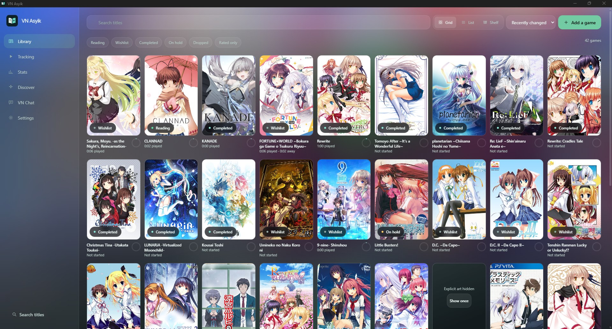

# VN Asyik

A visual novel library and playtime tracker for Windows and Android. It reads
from VNDB, keeps everything in a local SQLite database, and works with no
network. Rust and Tauri on the backend, React on the front.

**English** · [Bahasa Indonesia](README.id.md)



## What it does

**Library.** Search VNDB and import a game with its cover, tags, ratings and
screenshot gallery. Browse as a grid, list or shelf; all three are virtualized.
Explicit covers stay concealed behind a neutral surface until you ask to see
one, and changing that setting conceals them again.

**Playtime.** Start a game from the app and it records how long you actually
read. Time counts only while the game is in front of you; breaks longer than a
configurable threshold are filed as away time instead of playtime, and stored
separately so you can see both. Sessions are written every 20 seconds, so a
crash or a forced reboot costs you seconds, not an evening.

**Chapters and endings.** Routes are yours: you name them, and endings hang off
them. Chapter detection reads the game's window caption where the engine writes
one (see [Chapters from the window title](#chapters-from-the-window-title)) and
falls back to game-level attribution where it does not, which is the honest
answer for a game that reports nothing.

**Stats.** Playtime by game, route and month, from the sessions themselves.

**Discord Rich Presence.** Optional, off by default. Shows what you are reading,
rotating through whatever fields you configure. Explicit cover art is blurred
before it is ever sent anywhere, if you opt into an image host at all.

**Walkthroughs.** Pull route choices directly from the Seiya-Saiga index
covering over 4,800 PC and console titles. Step-by-step choices, route branches,
and ending badges are organized into clean tabs, backed by normalized Japanese
title search and inline translation options.

**Recommendations.** Ask what to read next. Suggestions are shaped by your
taste profile and local vector embeddings, or through open-web searches via
Tavily that always link back to cited sources rather than guessing without
receipts.

**Sync and backups.** Sync libraries and sessions across devices over a shared
folder on your local network (LAN) without third-party servers. Or export your
entire collection into a single `.vn-asyik-library` file with transparent
conflict review on import.

**Command palette.** Press `Ctrl+K` (or `Cmd+K`) anywhere for quick keyboard
navigation: jump across screens, find any title in your library instantly, and
trigger common actions.

**Background operation & System Tray.** On desktop, hide VN Asyik into the taskbar
notification area (system tray) using the sidebar button, `Ctrl+Shift+H`, the Command
Palette, or simply by closing the window ('X'). Playtime tracking and LunaTranslator
text hooking continue seamlessly in the background while you read your visual novel,
and the window can be instantly restored by clicking the tray icon.

**Android.** Playtime comes from `UsageStats` foreground events, which needs the
Usage Access permission — whether running games natively or inside emulators.
Android cannot see inside another app's windows, so chapters there are set by
hand and the app says so rather than guessing.

## Chapters from the window title

On desktop, chapters come from what the game writes in its own window caption:
no injection, no memory reading, nothing that a game update can break. Siglus
puts its progress there, and these shapes are verified:

```text
Summer Pockets REFLECTION BLUE 静久 ８月７日   route 静久, chapter 8月7日
anemoi Ｄａｙ １                              chapter Day 1
anemoi アネモイ Ｃｈａｐｔｅｒ ０１            route アネモイ, chapter Chapter 01
```

Full-width characters are folded before matching, so `Ｄａｙ １` and `Day 1` read
the same. A caption with no marker — the title screen, a menu — attributes
nothing rather than inventing a chapter, a bare number is not a chapter, and a
caption that does not name the game you track is ignored.

### Custom pattern

If your game writes a shape none of those cover, open **Settings → General →
Reading chapters from window titles**, set **Source** to **Custom pattern**, and
fill in a pattern. It is Rust [`regex`](https://docs.rs/regex) 1.x syntax —
linear-time, no look-around, no backreferences, at most 512 bytes (about 170
Japanese characters) — and it runs against the whole caption the way the game
wrote it, game name included.

- **Two groups:** the first is the route, the second is the chapter.
- **One group:** it is the chapter.

At least one group is required — a pattern without one is refused when you save.
Groups that did not take part in the match are skipped, so an optional route
group leaves just the chapter.

Two properties of that dialect are worth knowing for Japanese captions: `\d`
matches any Unicode digit (full-width `１２` included), and `(?i)` gives
case-insensitive matching.

For a caption like `Fate/stay night [Fate] Day 3`:

```text
^.*?\[(.+)\]\s*(.+)$    route "Fate", chapter "Day 3"
^.*?\s(Day \d+)$        chapter "Day 3"            (one group)
```

What to know before saving:

- The pattern is not anchored: it matches anywhere in the caption unless you
  write `^` and `$` yourself.
- A match whose group captured nothing is treated as no match — an empty chapter
  name is worse than none.
- Custom patterns do **not** fold full-width characters: `Day` never matches
  `Ｄａｙ`, because they are different characters. For a caption written that way,
  either put those characters in the pattern or leave the source on **Siglus**,
  which folds them.
- **Test** runs the pattern against the sample caption, prefilled from whichever
  window was in front when the panel opened — edit it to try another. Test
  before saving: a pattern that never matches looks exactly like a game that
  writes no chapter, and nothing else in the app can tell them apart.

**Off** stops reading captions. The choice is stored locally on this device.
Android never reads captions — the OS does not allow it — so chapters there are
set by hand.

## Companion chat

The chat is not a general assistant bolted onto a library. It can read two
things and cite them:

- **Live text.** Text LunaTranslator extracted from the game you are playing
  right now.
- **Imported scripts.** Drop in a script you extracted yourself — plain text, a
  name/message JSON array, or the Asyik JSON format — and the app compacts it
  into a story digest it can answer from.

Compaction is a map-reduce over the script split into byte-budgeted chunks. Up
to 10 agents summarize contiguous segments in parallel, each carrying the tail
of its own previous outline for continuity, then their segment digests merge
into one. Progress is saved per chunk, so closing the app mid-run and coming
back resumes where it stopped instead of starting over.

Digests are withheld unless the chat's spoiler level is set to _All_. Live text
is not, because you already read it.

## What it will not do

Some of this is a platform limit and some is a decision, but either way the app
tells you rather than pretending.

- **No chapter detection on Android.** The OS does not let one app inspect
  another's window. Chapter and route are manual there.
- **The app never writes to a running game.** It does not patch files, re-inject
  translated text, or touch DRM.
- **No telemetry.** No analytics, no crash reporting, no phone-home. The only
  network calls are the ones you turn on: VNDB, Discord, your own chat provider,
  and Tavily if you ask for a recommendation that needs the open web.

## Install

Builds are produced locally; there is no signed public release yet.

```
pnpm install --frozen-lockfile
pnpm tauri build
```

Output lands in `src-tauri/target/release/bundle/`. Android needs JDK 21, the
Android SDK and NDK, and the Android Rust target:

```
pnpm tauri android build --apk --target aarch64
```

The application ID is `com.atho.vnasyik`. Android keys app data, the Keystore
credential store and the Usage Access grant to that string, so it is permanent:
changing it again makes the store treat the app as a different installation.

## Upgrading from the `app.vntracker.desktop` build

The package was renamed once, before the first public release. A build made
before the rename cannot update in place, because Android sees a different app:
it installs alongside the old one with an empty library.

- **Android:** export with _Settings → Backup & transfer_ in the old build, then
  import in this one.
- **Windows:** the library lives in `%APPDATA%\com.atho.vnasyik\`. Copy the
  folder from `%APPDATA%\app.vntracker.desktop\` before the first launch, and
  the games, sessions and settings come with it.

## Development

```
pnpm install --frozen-lockfile
pnpm tauri dev
```

```
pnpm lint && pnpm typecheck && pnpm test
cargo fmt --check && cargo clippy --all-targets -- -D warnings
cargo test --workspace
```

The live tracking tests touch real windows and real idle time, so they are
ignored by default:

```
cargo test --test tracking_live -- --ignored --nocapture
```

Android compile check, which catches code that leaks out from behind a
`#[cfg]` gate:

```
cargo check --target aarch64-linux-android -p vn-tracker
```

## Reading the code

`crates/vn-core` is the place to start: it holds the pure domain logic — the
session state machine, sync merge, chapter mapping, script compaction — with no
Tauri and no OS calls, so it tests with plain `cargo test`. `src-tauri/src` wraps
that in commands, storage and platform adapters. `src/` is the React frontend and
talks to the backend only through `src/lib/ipc`.

Comments in the code explain _why_ a rule exists where the rule is not obvious,
so the reasoning travels with the code rather than living in a separate
document.

## Prior art and attribution

Each entry below says what it actually gave this project. _Ported_ means code or
constants were copied and carry provenance comments in the source. _Inspiration_
means the project was read to understand a problem; nothing was copied, and no
obligation attaches to an idea.

**[VaternID/EwE](https://github.com/VaternID/EwE) — GPL-3.0 — ported.**
The Discord presence card is modelled on EwE. `crates/vn-core/src/presence.rs`
records what was taken: the per-field text transform pipeline (remove, replace,
prefix/suffix, trim, in that order) and the independent rotation cursor per
field. What was deliberately not taken is recorded too — EwE's custom Python
variable scripts, which execute arbitrary code from a directory beside the
executable, and its upload of cover art without a separate opt-in.

**[dead8309/Kizzy](https://github.com/dead8309/Kizzy) — GPL-3.0 — inspiration.**
The reference for talking to Discord on Android, where the desktop IPC socket
does not exist. The Android presence path connects to the Discord Gateway
directly instead, which is the approach Kizzy demonstrated. No code is shared.

**[Yukin0a/KireiBox](https://github.com/Yukin0a/KireiBox) — GPL-3.0 — inspiration.**
A reference for how Android VN launchers approach externally installed engines.
Its README draws the line between bundled engine runners and launching a
separately installed app; VN Asyik takes the second path and bundles nothing.

**[LunaTranslator](https://github.com/HIllya51/LunaTranslator) — GPL-3.0 — integrated.**
Connected through its documented network service: the websocket endpoint streams
extracted text as plain frames, which the app consumes. No code is copied; the
integration is a client for a documented API.

**LunaBox — AGPL-3.0 — inspiration only.**
Read as prior art for what an AI feature over a VN library could present, and for
which failure modes matter (spoilers, invented conclusions). Ideas and functional
behaviour are not copyrightable, so this created no obligation either way.

## License

GPL-3.0-only. See [LICENSE](LICENSE).
